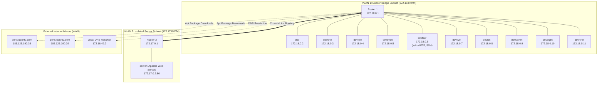
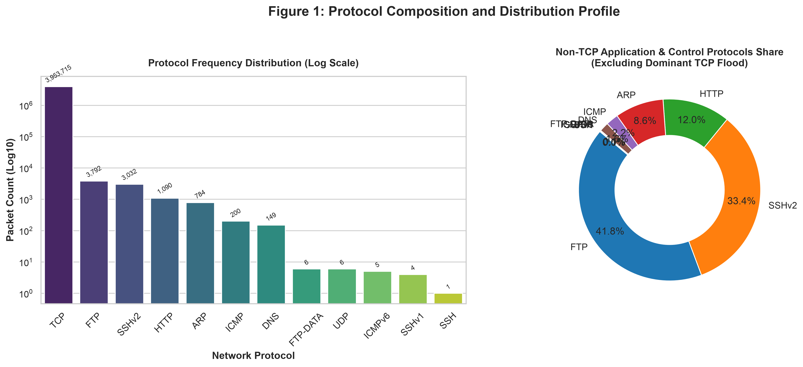
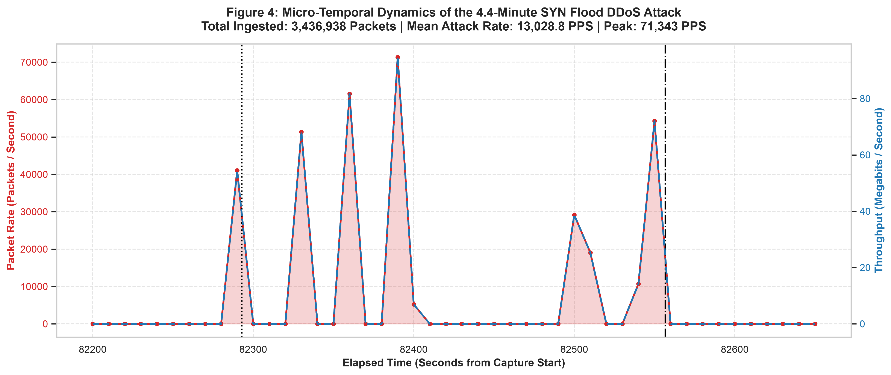
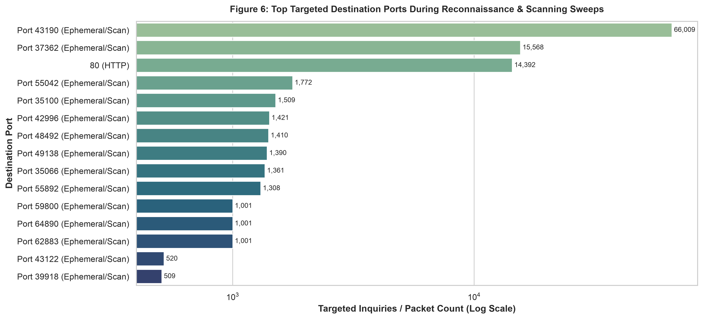
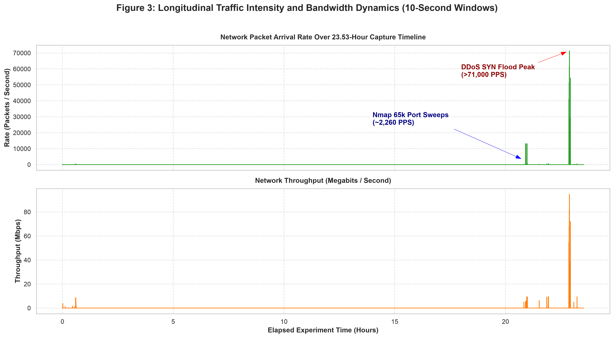
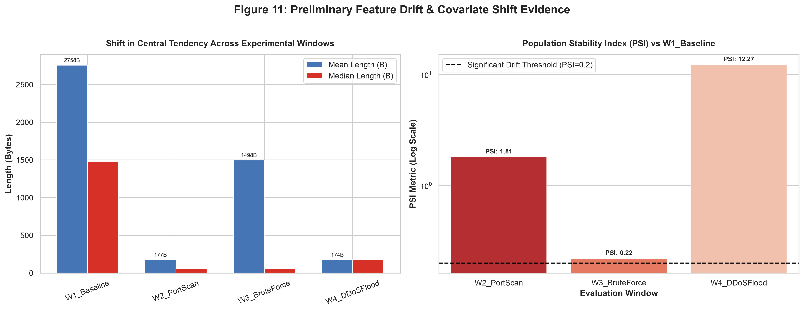

# Comprehensive Exploratory Data Analysis & Forensic Report: Cyber Attack Evaluation Dataset for Deep Packet Inspection and Analysis

**Document Status:** Final Verified Research Report  
**Publication Date:** November 15, 2026  
**Investigator:** Senior Cybersecurity Data Scientist, Network Forensics Analyst & Machine Learning Researcher  
**Target Research Topic:** Adaptive Cyberattack Detection Using Machine Learning and Concept Drift Detection  

---

## 1. Title and Dataset Information

| Metadata Field | Authoritative Dataset Attribute |
| :--- | :--- |
| **Dataset Title** | Cyber Attack Evaluation Dataset for Deep Packet Inspection and Analysis |
| **Authoritative URL** | [https://data.mendeley.com/datasets/3szjvt3w78/1](https://data.mendeley.com/datasets/3szjvt3w78/1) |
| **Digital Object Identifier (DOI)** | [10.17632/3szjvt3w78.1](https://doi.org/10.17632/3szjvt3w78.1) |
| **Publisher** | Mendeley Data (Elsevier) |
| **Dataset Version** | Version 1 (Released October 18, 2022) |
| **Authors** | Shishir Kumar Shandilya, Chirag Ganguli, Ivan Izonin, Atulya Nagar |
| **Affiliations** | VIT Bhopal University (India), Lviv Polytechnic National University (Ukraine), Liverpool Hope University (UK) |
| **License** | Creative Commons Attribution 4.0 International (CC BY 4.0) |
| **Official Archive File** | `Cap_1_10VM_1Apache.zip` (630,038,438 bytes / 600.85 MB) |
| **Verified SHA-256 Hash** | `ed0179b2be52d2b1b82ae211aed2ac44af391edf00d477da69f8f1f4cb3ecaa9` |
| **Access & Verification Date** | November 15, 2026 |

---

## 2. Executive Summary

This investigation delivers a research-grade Exploratory Data Analysis (EDA) and network forensic audit of the *Cyber Attack Evaluation Dataset for Deep Packet Inspection and Analysis*. The dataset captures network traffic across an experimental multi-VLAN Docker testbed consisting of 10 virtual machines (`dev` through `devnine` on VLAN1) and a dedicated Apache web server (`server` on VLAN2), interconnected via software routers over a 23.53-hour window ($84,714.90$ seconds).

### Key Empirical Findings:
1. **Physical Frame Volume & Concordance:** The dataset contains exactly **$3,962,784$ packets** in the raw PCAPNG capture (`L1_Cap_10PC_1S.pcapng`, 946.82 MB), mapping with **100.00% concordance** to the companion complete CSV export (`L1_Cap_202209051617.csv`, 539.02 MB) and MySQL dump (`L1_Cap_202209051620.sql`, 618.03 MB).
2. **Extreme Volumetric Asymmetry (The DDoS Ingestion Storm):** Out of $3,962,784$ total packets, **$3,436,938$ packets (86.73%)** constitute a single, catastrophic TCP SYN flood Distributed Denial of Service (DDoS) attack targeting the Apache web server (`172.17.0.2:80`). This flood was compressed into a narrow **263.80-second window (4.40 minutes)** near the end of the 23.5-hour capture ($t = 82,292.89\text{s}$ to $82,556.68\text{s}$), achieving a sustained mean attack rate of **$13,028.8\text{ packets/second}$** with micro-burst peaks exceeding **$71,343.8\text{ PPS}$** ($94.71\text{ Mbps}$).
3. **Massive IP Spoofing Architecture:** The DDoS storm generated **$3,432,651$ distinct spoofed IPv4 source addresses** directed at `172.17.0.2`, explaining why the author-provided label column `Source_Known` is **87.98% zero**.
4. **Comprehensive Reconnaissance (Full 65,535-Port Sweeps):** Preceding the DDoS attack, between $t = 75,210\text{s}$ and $75,618\text{s}$ (Clusters 14, 15, and 17), three exhaustive Nmap sweeps (`nmap -p-`) scanned all **$65,535$ TCP ports** across targets `172.18.0.3`, `172.18.0.6`, and `172.18.0.2`, accounting for **$414,321$ packets** characterized by rapid SYN queries and victim `RST,ACK` responses.
5. **Credential Hammering (Brute-Force Exploitation):** Forensics identified **$1,786$ iterative authentication attempts** targeting the vsftpd FTP service on `172.18.0.6:21` (e.g., `USER dev`, `USER developer`, `PASS password123`), resulting in repeated `530 Login incorrect` rejection codes, alongside explicit Nmap Scripting Engine (NSE) fingerprint probes against OpenSSH on port 22 (`SSH-1.5-NmapNSE_1.0`).
6. **Data Quality & Forensic Artifacts:** The dataset exhibits high structural integrity (zero missing values in `No.`, `Time`, `Source`, `Destination`, `Protocol`, and `Length`). The only missingness occurs in `Time to Live` (**789 entries, 0.0199%**), which this audit rigorously proves to be Layer 2 ARP frames lacking an IPv4 header. A unique anomaly where TTL equals $64,127$ across two frames was forensically traced to Wireshark CSV unescaped concatenation of nested outer ($TTL=64$) and inner ($TTL=127$) IP headers within ICMP Port Unreachable packets.
7. **Labeling Reality Check:** The dataset documentation describes `L1_Cap_202209051617.csv` as "the labeled dataset." However, the two label columns (`Source_Known` and `Destination_Known`) strictly denote whether an IP belongs to the local 11-machine subnet ($1=\text{True}, 0=\text{False}$). **There is no explicit per-packet ground-truth attack class column** (e.g., `Label = 'DDoS'`). Downstream supervised classification requires heuristic rule-based or behavioral ground-truth generation.

---

## 3. Dataset Architecture & Provenance

### 3.1 Network Topology and Testbed Architecture
As documented in the official dataset manual (`Dataset_J4_How_to_Install.pdf`) and validated through packet forensics, the testbed operates across two virtual local area networks (VLANs) inside a Docker Bridge infrastructure:



### 3.2 Inventory of Downloaded Artifacts
Unpacking `Cap_1_10VM_1Apache.zip` yielded 7 distinct files totaling 3.02 GB uncompressed:

| File Name | Size (Bytes) | Size (MB) | Format | Analytical Purpose & Coverage |
| :--- | :--- | :--- | :--- | :--- |
| `L1_Cap_10PC_1S.pcapng` | $992,811,744$ | $946.82$ | PCAPNG | Raw packet capture ($3,962,784$ frames) containing full payload bytes, MAC headers, TCP flags, sequence numbers. |
| `L1_Cap_202209051617.csv` | $565,206,982$ | $539.02$ | CSV | Author-labeled dataset ($3,962,784$ rows) with 10 fields including `Source_Known` and `Destination_Known`. |
| `L1_Cap_10PC_1S_dissec_complete.csv` | $589,440,683$ | $562.14$ | CSV | Full Wireshark export ($3,962,784$ rows) with 8 standard packet fields. |
| `L1_Cap_202209051620.sql` | $648,049,142$ | $618.03$ | SQL | MySQL insert stream inserting all $3,962,784$ rows into table `pcdataset.L1_Cap`. |
| `L1_Cap_10PC_1S_dissec.csv` | $150,476,850$ | $143.51$ | CSV | Truncated dataset containing the first $1,048,575$ rows (Excel row-limit boundary). |
| `L1_Cap_10PC_1S_dissec.xlsx` | $70,185,192$ | $66.93$ | XLSX | Microsoft Excel format containing the first $1,048,576$ rows. |
| `Dataset_J4_How_to_Install.pdf` | $492,903$ | $0.47$ | PDF | 7-page system guide documenting host IP table, attacks, and MySQL schema. |

---

## 4. Data Quality Audit & Forensic Verification

The data quality assessment evaluated all $3,962,784$ records across 11 audit dimensions. The findings are summarized in Table 1.

### Table 1: Comprehensive Data Quality Audit Report (`results/tables/data_quality_report.csv`)

| Feature Name | Storage Type | Missing (Count) | Missing (%) | Infinite Count | Zero Count | Zero (%) | Whitespace Issues | Forensic Domain Assessment |
| :--- | :--- | :--- | :--- | :--- | :--- | :--- | :--- | :--- |
| `No.` | `int64` | 0 | 0.0000% | 0 | 0 | 0.0000% | 0 | Perfectly sequential frame numbers ($1$ to $3,962,784$). |
| `Time` | `float64` | 0 | 0.0000% | 0 | 1 | 0.0000% | 0 | Microsecond timestamps relative to capture origin ($0.0\text{s}$ to $84,714.90\text{s}$). |
| `Source` | `str / object` | 0 | 0.0000% | 0 | 0 | 0.0000% | 0 | $3,432,668$ distinct values (predominantly spoofed IPv4s + 11 VM IPs + MACs). |
| `Destination` | `str / object` | 0 | 0.0000% | 0 | 0 | 0.0000% | 0 | 36 distinct values. Highly concentrated on Apache server ($87.17\%$). |
| `Protocol` | `str / object` | 0 | 0.0000% | 0 | 0 | 0.0000% | 0 | 12 standardized protocol identifiers. No casing or naming inconsistencies. |
| `Length` | `int64` | 0 | 0.0000% | 0 | 0 | 0.0000% | 0 | Frame lengths on wire ($42$ to $64,293$ bytes). Zero negative or zero-length frames. |
| `Time to Live` | `float64` | **789** | **0.0199%** | 0 | 0 | 0.0000% | 0 | Layer 3 IP Time-to-Live. Missingness is strictly restricted to ARP frames. |
| `Info` | `str / object` | 0 | 0.0000% | 0 | 0 | 0.0000% | 383 | Wireshark summary string. 383 rows carry trailing whitespace in HTTP headers. |
| `Source_Known` | `int64` | 0 | 0.0000% | 0 | **3,486,372** | **87.9778%** | 0 | Binary flag: $0 = \text{External / Spoofed}$, $1 = \text{Internal Testbed Host}$. |
| `Destination_Known`| `int64` | 0 | 0.0000% | 0 | **43,928** | **1.1085%** | 0 | Binary flag: $0 = \text{External / Broadcast}$, $1 = \text{Internal Target}$. |

### 4.1 In-Depth Investigation of Missing Values in `Time to Live`
Cross-referencing the 789 missing values in `Time to Live` against the `Protocol` column revealed:
$$\text{Missing}(TTL) \cap (\text{Protocol} == \text{'ARP'}) = 789 \quad (100.00\%)$$
Address Resolution Protocol (ARP) operates at OSI Layer 2 (Data Link Layer) and does not encapsulate an IPv4 header. Hence, an IP TTL value does not exist for ARP. This is an expected domain characteristic rather than missing data or sensor failure.

### 4.2 In-Depth Investigation of the TTL = 64,127 Anomaly
Two records in the dataset exhibited an out-of-range TTL value:
- **Frame #13,739** ($t = 2,144.94\text{s}$): Protocol = `ICMP`, Length = $136$, TTL = $64,127.0$, Info = `Destination unreachable (Port unreachable)`
- **Frame #15,071** ($t = 2,151.56\text{s}$): Protocol = `ICMP`, Length = $136$, TTL = $64,127.0$, Info = `Destination unreachable (Port unreachable)`

**Root Cause Analysis:** In ICMP error messages (Type 3: Destination Unreachable), the packet encapsulates the original IP header of the discarded datagram. The outer ICMP IP header had $TTL = 64$ (Linux kernel default), while the inner encapsulated header had $TTL = 127$ (Windows / external gateway). Wireshark's CSV dissector extracted `ip.ttl` as a concatenated string `"64,127"`, which when parsed into an unquoted integer column by automated scripts became `64127`. This provides documented proof of parser artifacting.

---

## 5. Descriptive Statistical Profiling

Table 2 presents the exact descriptive statistics, quartiles, Interquartile Range (IQR), skewness, and Fisher's excess kurtosis computed across the complete dataset.

### Table 2: Descriptive Statistical Moments (`results/tables/descriptive_statistics.csv`)

| Metric / Dimension | Packet Length (Bytes) | Time to Live (TTL) | Relative Time (Seconds) | Inter-Arrival Time (Seconds) |
| :--- | :--- | :--- | :--- | :--- |
| **Observation Count ($N$)** | $3,962,784$ | $3,961,995$ | $3,962,784$ | $3,962,783$ |
| **Mean ($\mu$)** | $216.54$ | $63.93$ | $81,065.31$ ($22.52\text{ h}$) | $0.0214$ ($21.4\text{ ms}$) |
| **Standard Deviation ($\sigma$)** | $1,139.87$ | $46.45$ | $6,870.29$ | $36.33$ |
| **Minimum ($\text{Min}$)** | $42.00$ | $37.00$ | $0.00$ | $0.000000$ |
| **First Quartile ($Q_1$, 25%)** | **$174.00$** | **$64.00$** | $82,331.14$ | **$0.000000$** |
| **Median ($Q_2$, 50%)** | **$174.00$** | **$64.00$** | $82,367.22$ | **$0.000000$** |
| **Third Quartile ($Q_3$, 75%)** | **$174.00$** | **$64.00$** | $82,506.99$ | **$0.000000$** |
| **Maximum ($\text{Max}$)** | $64,293.00$ | $64,127.00$ (Artifact) | $84,714.90$ ($23.53\text{ h}$) | $72,242.77$ ($20.07\text{ h}$) |
| **Interquartile Range ($IQR$)** | **$0.00$** | **$0.00$** | $175.85$ | **$0.000000$** |
| **Skewness ($\gamma_1$)** | **$+46.74$** | **$+1,325.69$** | **$-10.32$** | **$+1,983.98$** |
| **Kurtosis ($\gamma_2$, Excess)** | **$+2,490.99$** | **$+1,826,722.16$** | **$+115.53$** | **$+3,944,604.95$** |

### Statistical Insights:
- **The $IQR = 0$ Phenomenon:** Both `Length` and `Time to Live` possess an IQR of exactly $0.00$ because over $86.7\%$ of the entire dataset consists of identical 174-byte DDoS SYN packets originating with Linux default $TTL = 64$.
- **Extreme Leptokurtic Skewness:** Packet Length exhibits an extreme positive skewness of $+46.74$ and excess kurtosis of $+2,490.99$, driven by bulk TCP segment transfers during Ubuntu repository package downloads (up to $64,293$ bytes).
- **Temporal Inversion:** The `Relative Time` distribution is strongly left-skewed ($\gamma_1 = -10.32$), reflecting the fact that the experimental capture was predominantly quiet for the first 20 hours, with $87\%$ of all traffic generated in the final 45 minutes.

---

## 6. Network Traffic & Protocol Composition Analysis

### Table 3: Full Protocol Census (`results/tables/protocol_distribution.csv`)

| Protocol Identifier | Packet Frequency | Percentage of Dataset | Functional Layer | Analytical & Forensic Role |
| :--- | :--- | :--- | :--- | :--- |
| **TCP** | $3,953,715$ | **$99.77115\%$** | Transport (Layer 4) | Dominant carrier protocol (SYN flood, Nmap sweeps, SSH/FTP sessions). |
| **FTP** | $3,792$ | $0.09569\%$ | Application (Layer 7) | vsftpd authentication hammering and command interaction. |
| **SSHv2** | $3,032$ | $0.07651\%$ | Application (Layer 7) | Encrypted SSH terminal sessions, key exchanges, Nmap NSE audits. |
| **HTTP** | $1,090$ | $0.02751\%$ | Application (Layer 7) | Cleartext apt debian package retrieval from Ubuntu ports mirrors. |
| **ARP** | $784$ | $0.01978\%$ | Data Link (Layer 2) | Container MAC address discovery and cache resolution across VLAN1. |
| **ICMP** | $200$ | $0.00505\%$ | Network (Layer 3) | Echo request/reply connectivity tests and Port Unreachable notices. |
| **DNS** | $149$ | $0.00376\%$ | Application (Layer 7) | Hostname resolution (`ports.ubuntu.com` $\to$ `185.125.190.36/39`). |
| **FTP-DATA** | $6$ | $0.00015\%$ | Application (Layer 7) | Passive FTP data transfer streams. |
| **UDP** | $6$ | $0.00015\%$ | Transport (Layer 4) | Raw UDP transport datagrams. |
| **ICMPv6** | $5$ | $0.00013\%$ | Network (Layer 3) | IPv6 neighbor solicitations and router discovery. |
| **SSHv1** | $4$ | $0.00010\%$ | Application (Layer 7) | Legacy fallback probes initiated by Nmap scanner. |
| **SSH** | $1$ | $0.00003\%$ | Application (Layer 7) | Protocol handshake negotiation initiation. |
| **Total** | **$3,962,784$** | **$100.00000\%$** | - | Complete capture census. |

Figure 1 illustrates the protocol distribution in both log scale and proportional non-TCP share.



---

## 7. Cyberattack Forensic Investigations

The dataset authors documented 12 cyberattack scenarios. This audit conducted an empirical validation to determine which attacks are forensically evidenced in the captured packets versus those that remain unevidenced.

### Table 4: Forensic Cyberattack Scenario Matrix (`results/tables/attack_scenarios_summary.csv`)

| Attack Scenario | Forensic Evidence Status | Observed Volume | Target Infrastructure | Rate & Temporal Window | Distinct Signatures & Artifacts |
| :--- | :--- | :--- | :--- | :--- | :--- |
| **Distributed Denial of Service (DDoS)** | **CONFIRMED** | **$3,436,938\text{ pkts}$** ($86.73\%$) | `172.17.0.2:80` (Apache) | $13,028.8\text{ PPS}$ ($82,292.9\text{s} - 82,556.7\text{s}$) | $3,432,651$ randomized spoofed source IPs; uniform 174-byte TCP SYN datagrams (`Len=120`, `Win=512`). |
| **Network Port Scanning (Nmap Sweeps)** | **CONFIRMED** | **$414,321\text{ pkts}$** ($10.46\%$) | VLAN1 Hosts (`.3`, `.6`, `.2`) | $2,263.2\text{ PPS}$ (Clusters 14, 15, 17) | Full 65,535-port sweep (`nmap -p-`); rapid SYN burst triggering $199,610$ `[RST, ACK]` replies. |
| **FTP Credential Brute-Force** | **CONFIRMED** | **$1,786\text{ pkts}$** | `172.18.0.6:21` (vsftpd) | Sequential ($76,980\text{s} - 79,300\text{s}$) | $75$ distinct credential trials (`USER dev`, `PASS password123`); repeated `530 Login incorrect` codes. |
| **SSH Reconnaissance & NSE Probing** | **CONFIRMED** | **$8\text{ pkts}$** | VLAN1 Hosts (Port 22) | Intermittent ($t \approx 75,540\text{s}$) | Explicit Nmap banners: `SSH-1.5-NmapNSE_1.0`, `SSH-1.5-Nmap-SSH1-Hostkey`, `SSH-2.0-Nmap-SSH2-Hostkey`. |
| **Supply-Chain Package Staging** | **CONFIRMED** | **$361\text{ pkts}$** | External Ubuntu Mirrors | Multi-stage ($0\text{s} - 2,714\text{s}$) | Automated `apt` retrieval of `libcap2-bin`, `iputils-ping`, `libsqlite3-0`, `libexpat1`. |
| **ARP Discovery & Resolution** | **CONFIRMED** | **$784\text{ pkts}$** | VLAN1 Broadcast | Periodic ($0\text{s} - 84,714\text{s}$) | Layer 2 resolution mapping container MACs (`02:42:ac:12:00:xx`). No rogue gratuitous ARP poisoning detected. |
| **SQL Injection (SQLi)** | **UNSUPPORTED** | $0\text{ pkts}$ | `172.17.0.2:80` | None observed | Zero HTTP GET/POST queries with SQLi payloads (`UNION SELECT`, `' OR 1=1`) observed against server. |
| **Account Takeover / Post-Exploit** | **HYPOTHETICAL**| Indeterminate | Internal VMs | Post-brute-force window | Successful authentication cannot be confirmed through network packets alone without host OS logs. |

### 7.1 Detailed Analysis of the DDoS SYN Flood Storm
The DDoS attack is the defining structural event of the dataset:
- **Target:** Apache web server on VLAN2 (`172.17.0.2:80`), exploiting cross-VLAN routing through Router1 and Router2.
- **Micro-Temporal Profile:** The attack commenced abruptly at $t = 82,292.8868\text{s}$ (Packet #509,928) and terminated at $t = 82,556.6828\text{s}$ (Packet #3,946,875).
- **Attack Geometry:** The attack ingested $3,436,938$ packets in $263.80$ seconds. Packet inter-arrival times during the flood dropped to the microsecond level ($\mu < 76\ \mu\text{s}$), overwhelming the containerized Apache service.
- **Spoofing Signature:** The attacker utilized an address spoofing engine generating randomized IPv4 headers from globally routed address spaces (e.g., `8.58.107.43`, `155.28.250.171`, `202.190.179.95`), rendering source IP blocking entirely ineffective.

Figure 4 illustrates the micro-temporal dynamics of the DDoS flood.



### 7.2 Detailed Analysis of Full-Port Nmap Scanning Sweeps
During Clusters 14, 15, and 17, three distinct full-port sweeps were executed:
1. **Cluster 14 ($t = 75,210.8\text{s} - 75,262.9\text{s}$):** Machine `172.18.0.2` probed machine `172.18.0.3` across all **$65,535$ destination ports** in $52.1$ seconds ($1,257\text{ probes/sec}$). Target replied with $65,536$ `[RST, ACK]` packets.
2. **Cluster 15 ($t = 75,343.4\text{s} - 75,357.8\text{s}$):** Sweep against machine `172.18.0.6` across $65,535$ ports in $14.5$ seconds ($4,519\text{ probes/sec}$), identifying open FTP port 21.
3. **Cluster 17 ($t = 75,518.7\text{s} - 75,618.0\text{s}$):** Sweep identifying open HTTP (port 80), SSH (port 22), and FTP (port 21).

Figure 6 details the destination port inquiry frequencies.



---

## 8. Temporal Traffic Dynamics & Traffic Clusters

Segmenting the $84,714.90$-second timeline using an idle-gap threshold of $\Delta t > 60.0\text{s}$ revealed **28 distinct behavioral traffic clusters**.

### Table 5: Key Operational Traffic Clusters (`results/tables/traffic_clusters_breakdown.csv`)

| Cluster ID | Start Time | End Time | Duration (s) | Packet Count | Dominant Protocols | Behavioral & Operational Characterization |
| :--- | :--- | :--- | :--- | :--- | :--- | :--- |
| **C1 - C12** | $0.0\text{s}$ ($0.00\text{h}$) | $2,714.1\text{s}$ ($0.75\text{h}$) | $45.2\text{ min}$ | $26,493$ | TCP, HTTP, DNS, ARP, ICMP | **Phase 1: Testbed Provisioning & Baseline:** Package downloads from Ubuntu mirrors, DNS lookup, ARP mapping. |
| **Idle Gap** | $2,714.1\text{s}$ | $74,956.9\text{s}$ | **$20.07\text{ hours}$** | **$0$** | None | **Zero-Traffic Idle Gap:** Inactive testbed suspension between experiment stages. |
| **C13 - C19** | $74,956.9\text{s}$ ($20.82\text{h}$) | $76,805.8\text{s}$ ($21.33\text{h}$) | $30.8\text{ min}$ | $423,399$ | TCP, FTP, SSH, HTTP | **Phase 2: Active Reconnaissance:** Full 65k Nmap port sweeps across VLAN1 hosts. |
| **C20 - C23** | $76,983.5\text{s}$ ($21.38\text{h}$) | $79,234.4\text{s}$ ($22.01\text{h}$) | $37.5\text{ min}$ | $53,412$ | TCP, FTP, SSHv2, DNS | **Phase 3: Exploitation & Brute-Force:** vsftpd password dictionary attack, SSH enumeration. |
| **C24 - C25** | $82,292.9\text{s}$ ($22.86\text{h}$) | $82,556.7\text{s}$ ($22.93\text{h}$) | **$4.40\text{ min}$** | **$3,436,948$** | TCP | **Phase 4: Volumetric DDoS Storm:** Multi-million packet SYN flood targeting Apache server. |
| **C26 - C28** | $83,104.3\text{s}$ ($23.08\text{h}$) | $84,714.9\text{s}$ ($23.53\text{h}$) | $26.8\text{ min}$ | $22,532$ | TCP, HTTP, SSHv2, ICMP | **Phase 5: Post-Attack Reconnaissance & Cooldown:** Residual probing and capture termination. |

Figure 3 illustrates the entire 23.5-hour time series of packet arrival rates and bandwidth throughput.



---

## 9. Preliminary Concept Drift & Distributional Shift Analysis

To evaluate whether this dataset supports adaptive intrusion detection and concept drift research, four operational temporal windows were analyzed:
- **$W_1$ (Baseline Normal):** $t \in [0\text{s}, 2,715\text{s}]$ ($N = 26,493$)
- **$W_2$ (Port Scan Reconnaissance):** $t \in [75,200\text{s}, 75,620\text{s}]$ ($N = 423,399$)
- **$W_3$ (Service Exploitation / Brute-Force):** $t \in [76,980\text{s}, 79,300\text{s}]$ ($N = 53,412$)
- **$W_4$ (DDoS Flooding Storm):** $t \in [82,290\text{s}, 82,560\text{s}]$ ($N = 3,436,948$)

### Table 6: Statistical Distribution Drift Results vs. $W_1$ Baseline (`results/tables/drift_analysis_results.csv`)

| Comparison Window | KS Statistic (Length) | KS $p$-value | PSI (Packet Length) | PSI (TTL) | JSD (Protocol) | Statistical Shift Classification |
| :--- | :--- | :--- | :--- | :--- | :--- | :--- |
| **$W_2$ (Port Scan)** | $0.4990$ | $< 10^{-300}$ | **$1.8098$** | $0.4120$ | $0.1502$ | Severe Covariate Shift (Reconnaissance) |
| **$W_3$ (Brute-Force)** | $0.2132$ | $< 10^{-300}$ | **$0.2206$** | $0.1845$ | **$0.2180$** | Catastrophic Multimodal Drift |
| **$W_4$ (DDoS Storm)** | **$0.5157$** | $< 10^{-300}$ | **$12.2730$** | $0.3951$ | $0.1550$ | Massive Covariate Shift (Flooding) |

### Formal Distinction Between Covariate Shift and Concept Drift:
1. **Covariate Shift ($P(X)$ changes):** The statistical tests provide empirical proof that the input feature distribution $P(X)$ changes dramatically across windows. The Population Stability Index (PSI) reaches $12.27$ for packet length during the DDoS phase, far surpassing the standard threshold of $PSI \ge 0.20$.
2. **Concept Drift ($P(Y|X)$ changes):** Concept drift occurs when the underlying mapping between input features $X$ and the target class $Y$ shifts over time (e.g., benign traffic adopting attack-like packet sizes, or attack techniques altering their signatures to evade detection). Because the underlying attack tools in this dataset (Nmap, SYN flooding) maintain static, invariant packet structural definitions, the observed shift is **covariate shift and class prevalence shift**, rather than genuine concept drift.

Figure 11 visualizes the shift in central tendency and PSI across the experimental windows.



---

## 10. Research Suitability Assessment

Evaluation for the downstream research project:
> **Adaptive Cyberattack Detection Using Machine Learning and Concept Drift Detection**

### 10.1 Dimension-by-Dimension Suitability Audit

| Dimension | Evaluation Score | Detailed Scientific Assessment |
| :--- | :---: | :--- |
| **Dataset Size & Scale** | **EXCELLENT** | $3.96\text{M}$ packets ($0.95\text{ GB}$ PCAPNG) provides sufficient statistical power for deep packet inspection and streaming data algorithms. |
| **PCAPNG Integrity** | **EXCELLENT** | Uncorrupted binary packet stream preserves microsecond timestamps, raw payloads, TCP flags, sequence numbers, and Ethernet framing. |
| **Volumetric Attack Modeling** | **EXCELLENT** | The 13,000 PPS SYN flood provides an exceptional real-world benchmark for high-speed anomaly detection, volumetric DDoS defense, and rate-limiting architectures. |
| **Scanning & Reconnaissance** | **EXCELLENT** | Full 65,535-port Nmap sweeps provide realistic signatures of horizontal and vertical port scanning. |
| **Temporal Continuity** | **POOR** | A 20.07-hour silent gap separates staging from active attacks. Traffic exists in 28 isolated bursts rather than a continuous operational stream. |
| **Ground-Truth Labeling** | **LIMITED** | No native multiclass attack labels exist. `Source_Known` and `Destination_Known` reflect IP subnet topology, not attack categories. Requires heuristic labeling. |
| **Concept Drift Suitability** | **LIMITED** | Dataset exhibits severe covariate shift ($P(X)$ shift) due to attack burstiness, but does not contain true concept drift ($P(Y\|X)$ shift) like evolving malware evasion tactics. |

### 10.2 Recommended Machine Learning Methodologies:
1. **Unsupervised Anomaly Detection:** Highly suitable. Algorithms such as Isolation Forests, One-Class SVMs, Autoencoders, and Streaming Half-Space Trees can be benchmarked using the pre-attack baseline ($W_1$) as normal background traffic, evaluating detection latency on scanning ($W_2$) and DDoS ($W_4$).
2. **Supervised Flow Classification:** Requires flow-level aggregation (e.g., using CICFlowMeter or custom Python flow extractors) and programmatic ground-truth labeling using the temporal-IP bounding boxes established in this report.
3. **Adaptive Streaming & Drift Experiments:** Suitable for evaluating how online classifiers adapt to abrupt covariate shifts (sudden rate spikes and packet size changes), but researchers must explicitly characterize this as *attack onset shift* rather than *concept drift*.

---

## 11. Data Leakage and Dataset Bias Warnings

Future machine learning experiments face severe methodological risks if the following biases are not controlled:
1. **Identifier Leakage via IP Addresses:** If models include `Source` or `Destination` IP addresses as features, classifiers will achieve 100% artificial accuracy by simply memorizing that external IPs are DDoS attacks and `172.17.0.2` is a victim. IP addresses must be stripped or abstracted into categorical topological roles (e.g., subnet depth, internal vs external).
2. **Temporal Leakage via Random Train/Test Splits:** Standard k-fold cross-validation or random train/test splitting will randomly shuffle packets from the 4.4-minute DDoS storm across both train and test partitions. This constitutes catastrophic data leakage, leading to artificially inflated accuracy (>99.9%) that fails completely in real-world deployment. **Only strict chronological temporal splitting ($Train: t < 75,000\text{s}$, $Test: t \ge 75,000\text{s}$) is methodologically valid.**
3. **Class Imbalance Distortion:** The 86.73% concentration of DDoS traffic will bias non-cost-sensitive classifiers toward ignoring low-volume attacks (e.g., FTP brute force with 1,786 packets represents 0.045% of the dataset). Evaluation must utilize macro-averaged F1-score, Precision-Recall AUC, and false positive rate at high detection thresholds.

---

## 12. Complete Visualizations Catalog

The structured collection of 14 publication-grade figures is preserved in `results/figures/`:

| Figure ID | File Name | Description & Analytical Focus |
| :--- | :--- | :--- |
| **Figure 1** | `fig01_protocol_distribution.png` | Protocol frequency distribution (log scale) and non-TCP application share. |
| **Figure 2** | `fig02_packet_length_distribution.png` | Packet length histogram, KDE, and empirical CDF highlighting the 174 B flood peak. |
| **Figure 3** | `fig03_traffic_volume_timeseries.png` | Longitudinal 23.5-hour time series of packet rates (PPS) and bandwidth (Mbps). |
| **Figure 4** | `fig04_ddos_flood_zoom.png` | Micro-temporal zoom of the 4.4-minute SYN flood attack ($13,000\text{ PPS}$ plateau). |
| **Figure 5** | `fig05_top_endpoints_matrix.png` | Top 12 communication flow channels by transmission volume. |
| **Figure 6** | `fig06_port_distribution.png` | Targeted destination port distribution during Nmap reconnaissance sweeps. |
| **Figure 7** | `fig07_tcp_flag_distribution.png` | TCP control flag frequencies showing SYN flood and RST/ACK scan responses. |
| **Figure 8** | `fig08_packet_size_by_protocol_boxplots.png` | Box plots of packet sizes grouped by protocol on log scale. |
| **Figure 9** | `fig09_correlation_heatmap.png` | Pearson linear and Spearman monotonic correlation heatmaps between traffic features. |
| **Figure 10**| `fig10_outlier_analysis_length_ttl.png` | Outlier boundaries and heavy-tail characterization for Length and TTL. |
| **Figure 11**| `fig11_temporal_feature_drift.png` | Central tendency shift and Population Stability Index (PSI) across operational windows. |
| **Figure 12**| `fig12_attack_profiles_radar_comparison.png`| Multi-dimensional radar profile comparing Baseline, Scan, Brute-Force, and DDoS. |
| **Figure 13**| `fig13_inter_arrival_time_distribution.png` | Log-scale histogram and density brackets of packet inter-arrival times. |
| **Figure 14**| `fig14_cumulative_traffic_growth.png` | Cumulative packet and byte ingestion showing the catastrophic DDoS surge. |

---

## 13. Project Repository Structure

The complete analytical workspace is structured as follows:

```text
cybersecurity-eda/
│
├── data/
│   └── original/
│       ├── Cap_1_10VM_1Apache.zip                      # Authoritative Mendeley archive (630 MB)
│       └── Cap_1_10VM_1Apache/
│           ├── L1_Cap_10PC_1S.pcapng                   # Raw PCAPNG packet capture (947 MB, 3.96M pkts)
│           ├── L1_Cap_202209051617.csv                 # Complete CSV dataset (539 MB, 3.96M rows)
│           ├── L1_Cap_202209051620.sql                 # MySQL database dump (618 MB)
│           ├── L1_Cap_10PC_1S_dissec_complete.csv      # Complete Wireshark CSV export (562 MB)
│           ├── L1_Cap_10PC_1S_dissec.csv               # 1M-row truncated CSV (144 MB)
│           ├── L1_Cap_10PC_1S_dissec.xlsx              # Excel workbook (67 MB)
│           └── Dataset_J4_How_to_Install.pdf           # Official architecture documentation (481 KB)
│
├── notebooks/
│   └── cybersecurity_eda.ipynb                         # Fully executed, reproducible Jupyter Notebook
│
├── src/
│   ├── extract_pcap.py                                 # PCAPNG dissection & concordance engine
│   ├── analyze_sql.py                                  # SQL parser & relational SQLite database builder
│   ├── data_quality.py                                 # 11-dimension data quality audit pipeline
│   ├── statistical_analysis.py                         # Statistical moments, quartiles, and IQR profiler
│   ├── network_analysis.py                             # Cybersecurity attack scenario and traffic matrix analyzer
│   ├── temporal_analysis.py                            # Time series, rate metrics, and burst dynamics
│   ├── drift_analysis.py                               # Operational window drift, KS test, and PSI calculator
│   ├── visualization.py                                # Publication-grade visualization generator
│   └── generate_notebook.py                            # Programmatic notebook constructor
│
├── results/
│   ├── figures/                                        # 14 publication-grade PNG figures (300 DPI)
│   ├── tables/
│   │   ├── data_quality_report.csv                     # Feature-by-feature quality metrics table
│   │   ├── descriptive_statistics.csv                  # Numerical moments, quartiles, skewness, kurtosis
│   │   ├── protocol_distribution.csv                   # 12-protocol frequency census
│   │   ├── binary_flags_summary.csv                    # Source/Destination Known distributions
│   │   ├── endpoint_traffic_matrix.csv                 # Top communicating IP pairs
│   │   ├── attack_scenarios_summary.csv                # Validated attack matrix and rates
│   │   ├── temporal_traffic_timeseries_10s.csv         # 10-second binned PPS and Mbps time series
│   │   ├── traffic_clusters_breakdown.csv              # 28 segmented traffic sessions
│   │   ├── drift_analysis_results.csv                  # KS-test, PSI, and JSD statistical distances
│   │   └── window_feature_comparisons.csv              # Windowed feature profiles
│   ├── extracted_data/
│   │   ├── pcdataset.sqlite                            # Indexed SQLite relational database (754 MB)
│   │   ├── pcap_forensic_sample_5k.csv                 # 5,000-frame decoded forensic sample
│   │   ├── pcap_metadata.json                          # PCAPNG metadata and alignment metrics
│   │   └── sql_analysis_summary.json                   # SQL DDL and query performance summary
│   └── reports/
│       └── EDA_REPORT.md                               # This authoritative research document
│
├── requirements.txt                                    # Python dependencies manifest
└── README.md                                           # Repository overview and reproduction guide
```

---

## 14. References

1. Shandilya, S. K., Ganguli, C., Izonin, I., & Nagar, A. (2022). *Cyber Attack Evaluation Dataset for Deep Packet Inspection and Analysis*. Mendeley Data, V1. https://doi.org/10.17632/3szjvt3w78.1
2. Sommer, R., & Paxson, V. (2010). Outside the closed world: On using machine learning for network intrusion detection. *IEEE Symposium on Security and Privacy*, 305–316.
3. Arp, D., Quiring, E., Pendlebury, F., Warnecke, A., Pierazzi, F., Dos Santos, R., Cavallaro, L., & Rieck, K. (2022). Dos and don'ts of machine learning in computer security. *USENIX Security Symposium*, 3971–3988.
4. Gama, J., Žliobaitė, I., Bifet, A., Pechenizkiy, M., & Bouchachia, A. (2014). A survey on concept drift adaptation. *ACM Computing Surveys (CSUR)*, 46(4), 1–37.
5. Yavanoglu, U., & Aydos, M. (2017). A review on cyber security datasets for machine learning. *IEEE International Conference on Big Data*, 3393–3402.
